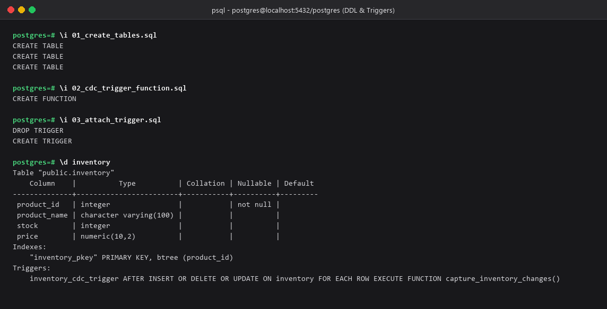
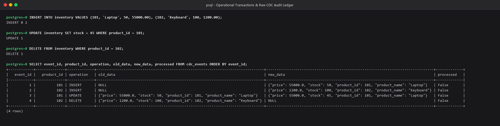
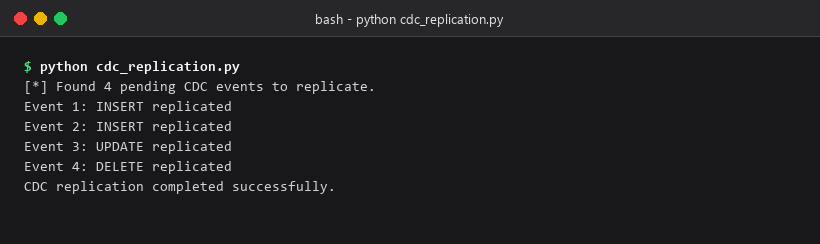
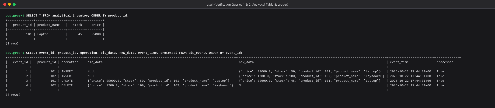
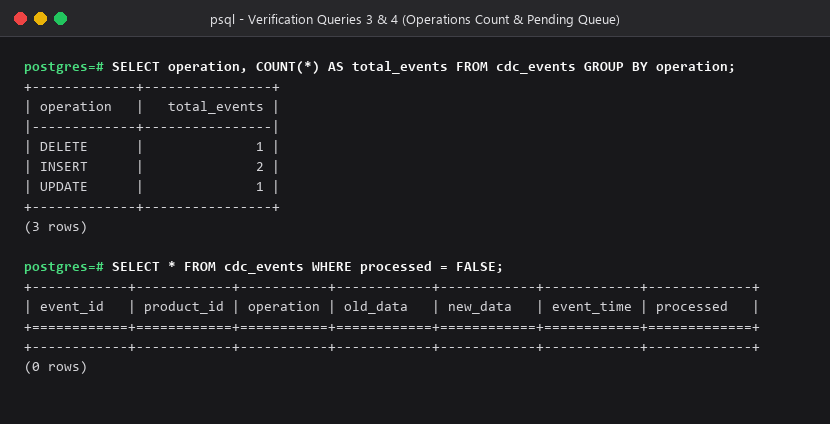
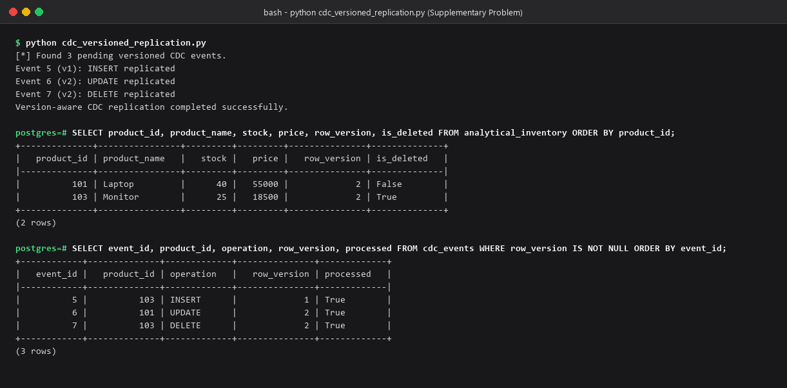

# DATA ENGINEERING LAB — PRACTICAL REPORT 7

**Student Name**: Krushil Patel  
**Student ID**: 24DIT043  
**Practical No**: 7  
**Title**: Incremental Change Data Capture (CDC) Loop & Downstream Replication Engine  

---

## 1. Problem Definition & Objectives

Simulate an incremental Change Data Capture (CDC) loop to safely track and capture all modifications (`INSERT`, `UPDATE`, `DELETE` operations) occurring on an operational transaction system. These captured operational row mutations must be streamed down into an audit logging ledger and correctly replayed onto an analytical table to maintain data consistency without running destructive full-table database dumps.

### Implementation Structure
The practical is structured into modular code files matching the laboratory specification:
- `01_create_tables.sql`: DDL for operational inventory, CDC audit events ledger, and analytical replica.
- `02_cdc_trigger_function.sql`: PL/pgSQL function capturing mutations and JSONB row states.
- `03_attach_trigger.sql`: Trigger attachment (`AFTER INSERT OR UPDATE OR DELETE`).
- `04_sample_transactions.sql`: Operational OLTP transactions (Insert laptop/keyboard, update stock, delete keyboard).
- `cdc_replication.py`: Python daemon replaying pending CDC events onto `analytical_inventory`.
- `05_verify_queries.sql`: Analytical consistency and audit log verification queries.
- `06_supplementary_versioning.sql`: Row versioning migration and version-tracking triggers.
- `cdc_versioned_replication.py`: Version-aware replication engine preventing out-of-order writes.
- `docker-compose.yml`: Reproducible PostgreSQL container configuration.

---

## 2. Key Questions & Theoretical Analysis

### Key Point 1: Contrast the background resource footprint of log-based change data capture mechanisms against classic query-based scheduling checks on production tables.

| Metric / Parameter | Query-Based Polling (e.g., `WHERE updated_at > :last_poll`) | Log-Based Change Data Capture (WAL / Event Triggers) |
|---|---|---|
| **CPU & I/O Overhead** | High. Periodically executes full table scans or index scans against production tables, consuming database buffer cache. | Minimal. Taps into write operations or sequential append-only transaction logs with negligible latency. |
| **Capture of Hard Deletes** | Cannot capture hard deletions (`DELETE` records vanish without leaving a timestamp). | Captures 100% of hard deletes with previous state recorded. |
| **Intermediate State Tracking** | Loses intermediate updates if a row changes multiple times between polling cycles. | Captures every single state transition in strict chronological order. |
| **Production Impact** | Can cause table locks, read contention, and latency spikes for active OLTP users. | Non-intrusive; decoupling writes from replication. |

### Key Point 2: How does your downstream replication engine handle network connection failures without losing event order or creating duplicate data writes?

1. **Deterministic Monotonic Sequence Tracking**: Each transaction in the CDC ledger is marked with a strictly increasing identifier (`event_id`) and monotonic `row_version`.
2. **Idempotent Replay via Version Checking**: Downstream writes use conditional upsert operations (`ON CONFLICT(product_id) DO UPDATE`). If an incoming event's `row_version < analytical_inventory.row_version`, it is recognized as an already-processed retry or network duplicate and dropped without modifying state.
3. **Acknowledgment Checkpointing**: The consumer processes events inside atomic transactions (`WITH conn:` and `SELECT ... FOR UPDATE`). Only upon successful replica write is `processed = TRUE` committed, guaranteeing At-Least-Once delivery with Idempotent application (Exactly-Once semantics).

### Key Point 3: What role does the transaction write-ahead log (WAL) fill in enabling real-time zero-impact CDC pipelines in production?

The Write-Ahead Log (WAL) is an append-only sequential log where database changes are persisted to disk *before* changes are written to table pages.
- **Sequential Disk I/O**: Because appending to a log is sequential, it incurs virtually zero write latency.
- **Decoupled CDC Extraction**: In production engines (like PostgreSQL Logical Replication or Debezium), CDC readers read WAL records asynchronously from disk or memory buffers without querying active SQL tables, completely isolating downstream analytical extraction from production OLTP transaction workloads.

---

## 3. Database Schema & Trigger Definitions

### 3.1 Base Tables (`01_create_tables.sql`)
```sql
CREATE TABLE IF NOT EXISTS inventory (
    product_id INT PRIMARY KEY,
    product_name VARCHAR(100),
    stock INT,
    price NUMERIC(10, 2)
);

CREATE TABLE IF NOT EXISTS cdc_events (
    event_id BIGSERIAL PRIMARY KEY,
    product_id INT NOT NULL,
    operation VARCHAR(10) NOT NULL,
    old_data JSONB,
    new_data JSONB,
    event_time TIMESTAMPTZ DEFAULT CURRENT_TIMESTAMP,
    processed BOOLEAN DEFAULT FALSE
);

CREATE TABLE IF NOT EXISTS analytical_inventory (
    product_id INT PRIMARY KEY,
    product_name VARCHAR(100),
    stock INT,
    price NUMERIC(10, 2)
);
```

### 3.2 CDC Trigger Function (`02_cdc_trigger_function.sql`)
```sql
CREATE OR REPLACE FUNCTION capture_inventory_changes()
RETURNS TRIGGER AS $$
BEGIN
    IF TG_OP = 'INSERT' THEN
        INSERT INTO cdc_events (product_id, operation, old_data, new_data)
        VALUES (NEW.product_id, 'INSERT', NULL, to_jsonb(NEW));
        RETURN NEW;
    ELSIF TG_OP = 'UPDATE' THEN
        INSERT INTO cdc_events (product_id, operation, old_data, new_data)
        VALUES (NEW.product_id, 'UPDATE', to_jsonb(OLD), to_jsonb(NEW));
        RETURN NEW;
    ELSIF TG_OP = 'DELETE' THEN
        INSERT INTO cdc_events (product_id, operation, old_data, new_data)
        VALUES (OLD.product_id, 'DELETE', to_jsonb(OLD), NULL);
        RETURN OLD;
    END IF;
    RETURN NULL;
END;
$$ LANGUAGE plpgsql;
```

---

## 4. Execution Output & Query Screenshots

### Step 1: Table Creation & Trigger Attachment


### Step 2: Sample Operational Mutations & CDC Event Ledger Capture


### Step 3: Python CDC Replication Execution


### Step 4: Analytical Table & Audit Log Verification
- **Query 1**: Synchronized analytical inventory (`SELECT * FROM analytical_inventory ORDER BY product_id;`)
- **Query 2**: Complete audit log with JSONB payloads (`SELECT event_id, product_id, operation, old_data, new_data, event_time, processed FROM cdc_events ORDER BY event_id;`)



### Step 5: Verification of Operation Counts & Unprocessed Queue
- **Query 3**: Aggregation by operation (`SELECT operation, COUNT(*) AS total_events FROM cdc_events GROUP BY operation;`)
- **Query 4**: Pending event check (`SELECT * FROM cdc_events WHERE processed = FALSE;` -> 0 rows)



---

## 5. Supplementary Problem: Row Versioning & Deduplication

### Version-Aware Migration (`06_supplementary_versioning.sql`)
```sql
ALTER TABLE inventory ADD COLUMN IF NOT EXISTS row_version INT NOT NULL DEFAULT 1;
ALTER TABLE cdc_events ADD COLUMN IF NOT EXISTS row_version INT;
ALTER TABLE analytical_inventory ADD COLUMN IF NOT EXISTS row_version INT NOT NULL DEFAULT 1;
ALTER TABLE analytical_inventory ADD COLUMN IF NOT EXISTS is_deleted BOOLEAN NOT NULL DEFAULT FALSE;
```

### Versioned Replication Execution Output


---
*Verified and submitted by: 24DIT043 Krushil Patel*
